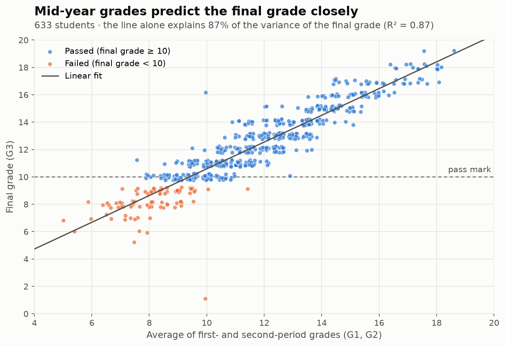
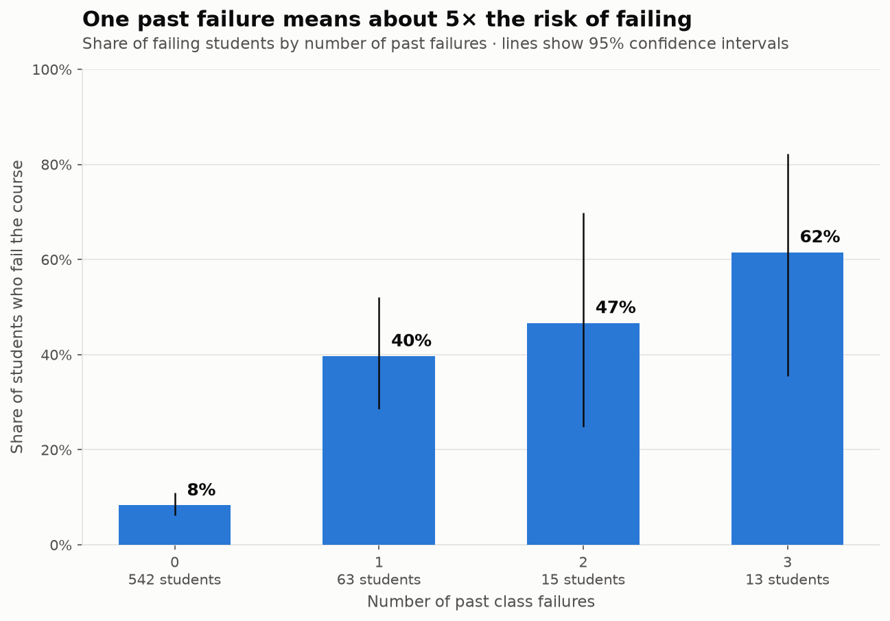
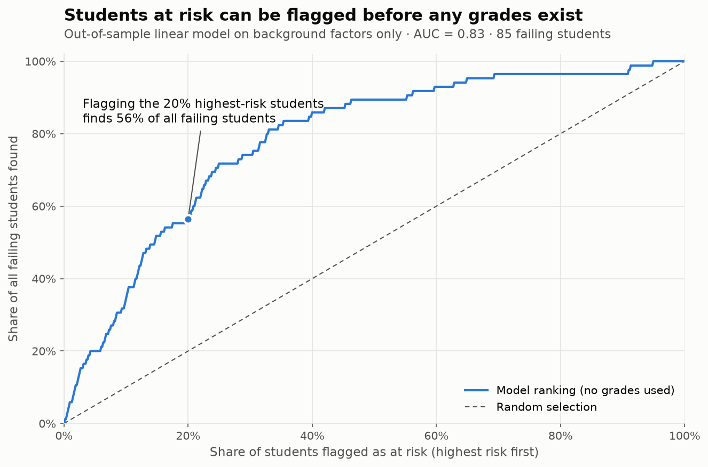

# Student Performance Analysis

Which factors are associated with secondary school students' final grades, and how much do they add once mid-year grades are known? This project explores these questions with statistical tests and models on data from 633 students taking the Portuguese language course at two Portuguese secondary schools.

The full analysis is in [`students_performance_analysis.ipynb`](students_performance_analysis.ipynb).

## Key Findings

- **Mid-year grades dominate.** The first- and second-period grades (`G1`, `G2`) explain $88\%$ of the variance of the final grade. Once they are known, no other factor adds statistically significant information, and a tuned XGBoost model with all features does no better than a linear model with `G1` and `G2` alone.
- **Past failures are the strongest early warning sign.** Without any grades, past class failures explain $18\%$ of the variance of the final grade ($\text{Spearman's} \rho = −0.43$), followed by plans for higher education and the mother's education level. Together with the school, past failures separate passing from failing students best ($\text{AUC} = 0.78$).
- **Background factors alone explain about 30%.** All non-grade factors together explain $27–31\%$ of the variance of the final grade, which is enough for a start-of-year early warning signal.
- **The two schools differ sharply.** $25.5\%$ of Mousinho da Silveira students fail, compared with $7.4\%$ at Gabriel Pereira, and 14 of the 15 students who missed the final exam were from Mousinho da Silveira.
- **School support and paid classes.** Students who receive them score slightly lower, but they also started the year with lower grades, so this data cannot show whether support works.

All findings are associations found in survey data, not causal effects.

## Key Findings in Charts



The average of the two mid-year grades alone explains 87% of the variance of the final grade (88% with `G1` and `G2` as separate predictors).



8% of students without past failures fail the course, compared with 40% of those with one past failure. The groups with 2 and 3 past failures are small (15 and 13 students), so their rates are uncertain.



Without any grades, a linear model ranks students by risk well enough that flagging the 20% highest-risk students finds 56% of all failing students, almost three times what random selection would find (out-of-sample predictions from 5-fold cross-validation, AUC = 0.83).

## Questions

1. Excluding prior grades, which single factor is most strongly associated with the final grade?
2. Once past performance (`G1` and `G2`) is taken into account, which factors still carry any signal for the final grade?
3. Which pair of factors best separates students who pass from those who fail?
4. How strongly are school support and paid extra classes related to outcomes?

## Data

The [Student Performance](https://archive.ics.uci.edu/dataset/320/student+performance) dataset from the UCI Machine Learning Repository (also published on [Kaggle](https://www.kaggle.com/datasets/uciml/student-alcohol-consumption) as *Student Alcohol Consumption*), originally collected by P. Cortez and A. Silva (*Using Data Mining to Predict Secondary School Student Performance*, 2008) from school reports and questionnaires.

The analysis uses the Portuguese language course data: 649 students, 33 columns covering demographics, family background, study habits, social life and three period grades. 16 students with a zero grade (15 of whom most likely missed the final exam) were removed, leaving 633.

## Approach

- **Exploratory analysis** grouped by family, educational and social factors, plus a comparison of the two schools. Plots show group sizes, and grades are also compared as fail / sufficient–good / very good–excellent categories based on the Portuguese grading scale.
- **Statistical tests** chosen for the data types: $\text{Spearman's} \rho$ and Kruskal–Wallis for ordinal features, Mann–Whitney U for two-group comparisons, $\eta^2$ as the effect size, and Holm correction for multiple comparisons.
- **Confounding checks**, for example parents' jobs within the same education level, and internet access within urban and rural homes.
- **Nested linear models with F-tests** to measure what each factor adds once mid-year grades are known.
- **Depth-2 decision trees** for all 435 pairs of features, compared fold by fold with repeated stratified cross-validation.
- **A tuned XGBoost model** compared with a linear baseline, with grouped permutation importance.

## Project Structure

```
.
├── docs/
│   └── data/
│       └── student-por.csv              # Portuguese course data
├── images/                              # charts used in this README
├── students_performance_analysis.ipynb  # the analysis
├── students_performance_viz.ipynb       # builds the charts in images/
├── requirements.txt
└── README.md
```

## How to Run

Requires Python 3.11 or newer.

```bash
git clone https://github.com/JusDice/Student-Performance-Analysis.git
cd Student-Performance-Analysis

python -m venv .venv
# Windows
.venv\Scripts\activate
# macOS / Linux
source .venv/bin/activate

pip install -r requirements.txt
```

Then open `students_performance_analysis.ipynb` in Jupyter or VS Code and run all cells. `students_performance_viz.ipynb` rebuilds the charts in `images/`.

The notebook uses [`dstoolset`](https://github.com/JusDice/dstoolset), a small package of EDA helpers I wrote for my own projects; it is installed automatically from PyPI by `requirements.txt`.

## Limitations

- The data come from a survey at a single point in time, so none of the findings show that changing a factor would change grades.
- Study habits, alcohol consumption and free time are self-reported on short scales.
- The data cover only two schools in one region of Portugal (school year 2005–2006).
- Some groups are small, so results for them are uncertain.

## Tools

Python, pandas, NumPy, SciPy, statsmodels, scikit-learn, XGBoost, matplotlib, seaborn, dstoolset.
